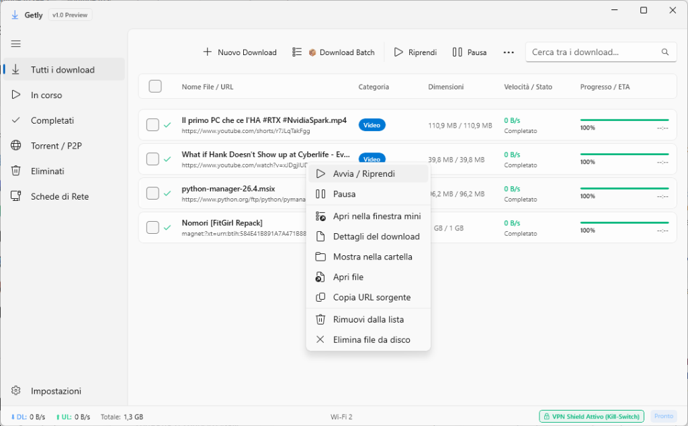
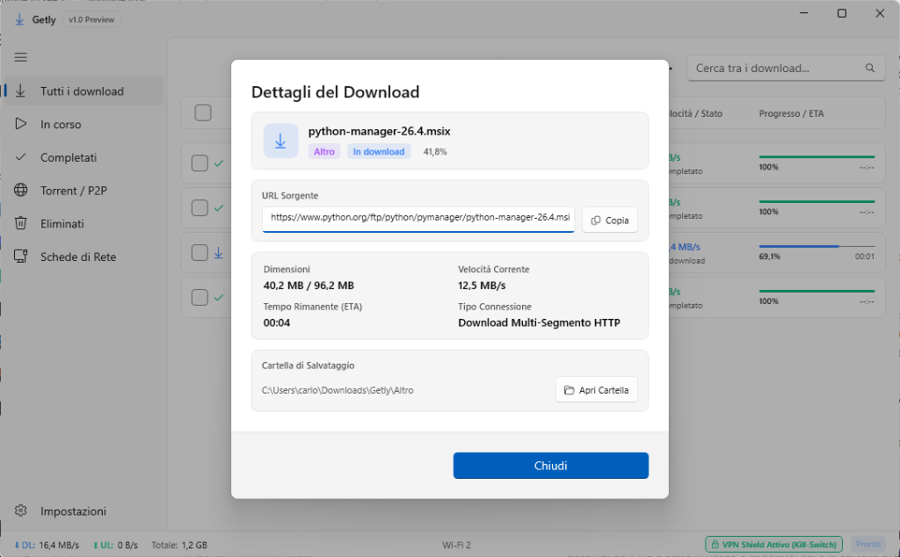
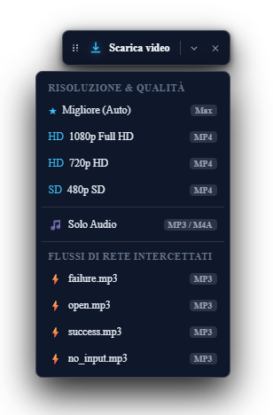

<p align="center">
  
</p>

<h1 align="center">Getly</h1>

<p align="center">
  <strong>High-Performance Multi-Interface Download Manager & BitTorrent Client for Windows</strong>
</p>

<p align="center">
  <a href="https://github.com/Cipr3sso/Getly/releases"></a>
  
  
  
  
  
</p>

---

## ⚡ What is Getly?

**Getly** is a modern, next-generation download manager and BitTorrent client engineered for speed, resilience, and a delightful user experience. 

Built with **WinUI 3 (Windows App SDK)** and a high-throughput multi-stream networking engine, Getly breaks free from the limitations of legacy download managers by introducing **multi-interface bandwidth aggregation ("Net-Merge")**, zero-copy positional storage, seamless browser integration, and native BitTorrent support in an elegant Windows 11 Fluent Design interface.

---

## ✨ Key Features

### 🚀 Multi-Interface Bandwidth Aggregation ("Net-Merge")
- **Aggregate Connections**: Combine your Wi-Fi, Ethernet, and 4G/5G mobile hotspot simultaneously to maximize download speeds.
- **Winsock `IP_UNICASTIF` Socket Binding**: Bypasses Windows Weak Host routing to guarantee traffic is physically dispatched across specific network adapters.
- **Real-Time NIC Monitor**: Track throughput per interface with dynamic on-the-fly adapter toggling and automatic link failover.

### 🎨 Native Windows 11 Fluent Interface
- **WinUI 3 & .NET 8**: Built using official Windows App SDK with native Mica backdrops, fluid animations, and dark/light mode support.
- **Floating Mini-Window**: Compact picture-in-picture overlay widget keeping tabs on active downloads without cluttering your workspace.
- **Real-Time Details Modal**: 200ms high-frequency live dashboard tracking speeds, ETA, dynamic progress, and torrent piece tables.
- **System Tray Integration**: Minimize to tray with native Win32 context menus and interactive Windows Toast notifications.

### 🧲 BitTorrent & P2P Engine
- **Powered by `libtorrent`**: High-performance P2P engine with magnet link support, DHT, PeX, tracker failover, and piece-level verification.
- **Selective File Downloading**: Inspect torrent metadata on the fly, set file priorities, and monitor individual file progress.
- **VPN Shield & Privacy Protection**: Automatic VPN detection (WireGuard, NordLynx, OpenVPN) with optional torrent kill-switch to prevent accidental public IP leaks.

### 🎥 Media Stream Grabber & Browser Extension
- **IDM-Style Floating Video Panel**: Injects a clean, non-intrusive floating downloader directly into YouTube and web video players.
- **Adaptive Stream Merging**: Captures separate audio and video DASH/HLS streams and automatically merges them using embedded `ffmpeg`.
- **Chromium Extension**: Full integration for Chrome, Brave, Edge, and Vivaldi with one-click download capture and background cookie forwarding.

### 🔐 Click'n'Load 2 & Filecrypt Support
- **Built-in CNL2 Server**: Listens on `127.0.0.1:9666` for seamless 1-click package imports from protected file-hosting services.
- **Sandboxed Decryptor**: Executes Click'n'Load JavaScript payloads inside an isolated engine (QuickJS / Dukpy) with AES-128-CBC decryption.

### 💾 Resilient Positional Storage & I/O
- **Win32 OVERLAPPED Non-Blocking I/O**: Direct positional asynchronous disk writes without file pointer contention.
- **Sparse Pre-Allocation**: Instant file reservation preventing filesystem fragmentation while avoiding zero-fill write overhead.
- **Crash Recovery**: SQLite WAL state journal preserves downloaded chunks across system restarts or network drops.

---

## 📸 Screenshots

<p align="center">
  
  <br>
  <em>Getly Main Dashboard — Windows 11 Fluent Design with active download monitoring & VPN shield</em>
</p>

<br>

<p align="center">
  
  <br>
  <em>Real-Time Download Details — Live 200 ms metrics, speed graphs, ETA, and segmented chunks</em>
</p>

<br>

<p align="center">
  
  <br>
  <em>IDM-Style Floating Video Downloader — Draggable quality selector embedded inside web video players</em>
</p>

---

## 🏗️ Architecture

```
┌────────────────────────────────────────────────────────┐
│               Getly.UI (WinUI 3 / .NET 8)              │
│       Mica Material • MVVM Toolkit • System Tray       │
└───────────────────────────┬────────────────────────────┘
                            │
               Named Pipe IPC (JSON-RPC)
                            │
┌───────────────────────────▼────────────────────────────┐
│              Getly Core Engine (Python 3.13)           │
├───────────────────────────┬────────────────────────────┤
│   Multi-Interface Net     │      libtorrent P2P        │
│  (Winsock IP_UNICASTIF)   │     (Magnet & Torrent)     │
├───────────────────────────┼────────────────────────────┤
│   Click'n'Load 2 Server   │   Win32 Overlapped I/O     │
│   (:9666 + JS Sandbox)    │  (Direct Positional Write) │
└───────────────────────────┴────────────────────────────┘
```

---

## 📥 Installation

### Option 1: Official Windows Installer (Recommended)
1. Head over to the **[Releases](https://github.com/Cipr3sso/Getly/releases)** page.
2. Download the latest `Getly_Setup.exe`.
3. Run the installer and launch **Getly** from your Start Menu or Desktop.

### Option 2: Standalone Portable Build
Download the portable archive from releases, extract it to any directory, and run `Getly.exe` directly.

---

## 🧩 Installing the Browser Extension

Getly includes a companion extension for **Google Chrome, Brave, Microsoft Edge, and Opera**:

1. In your browser, navigate to your extensions manager (e.g., `chrome://extensions` or `brave://extensions`).
2. Toggle on **Developer mode** in the top right corner.
3. Click **Load unpacked** (*Carica estensione non compattata*).
4. Select the `extensions/chrome` directory from this repository.
5. The Getly extension is now active! It will intercept downloads and provide floating video capture bars on media sites.

---

## 🛠️ Building from Source

### Prerequisites
- Windows 10 (version 19041+) or Windows 11
- [.NET 8.0 SDK](https://dotnet.microsoft.com/download/dotnet/8.0)
- [Python 3.10+](https://www.python.org/)
- [Inno Setup 6](https://jrsoftware.org/isinfo.php) *(optional, for creating setup installers)*

### 1. Clone the Repository
```powershell
git clone https://github.com/Cipr3sso/Getly.git
cd Getly
```

### 2. Set Up the Python Engine
```powershell
python -m venv .venv
.\.venv\Scripts\activate
pip install -r requirements.txt
```

### 3. Run the Desktop App (Development)
```powershell
dotnet run --project src/Getly.UI -c Debug -r win-x64
```

### 4. Run the Test Suites
```powershell
# Run .NET Unit Tests
dotnet test Getly.sln -v minimal

# Run Python Engine Tests
pytest -q
```

### 5. Build Distribution Package & Installer
```powershell
# Publish the WinUI 3 standalone binary
dotnet publish src/Getly.UI -c Release -r win-x64 --self-contained true -p:PublishSingleFile=false -p:AssemblyName=Getly -o dist/Getly

# Compile the Inno Setup installer
& "C:\Program Files (x86)\Inno Setup 6\ISCC.exe" installer.iss
```

---

## 🤝 Contributing

Contributions, issues, and feature requests are welcome!  
Feel free to check out the **[Issues page](https://github.com/Cipr3sso/Getly/issues)** to report bugs or submit feature proposals.

1. Fork the Project
2. Create your Feature Branch (`git checkout -b feature/AmazingFeature`)
3. Commit your Changes (`git commit -m 'feat: Add some AmazingFeature'`)
4. Push to the Branch (`git push origin feature/AmazingFeature`)
5. Open a Pull Request

---

## 📄 License

Distributed under the **MIT License**. See `LICENSE` for more information.

<p align="center">
  <sub>Crafted with passion for high-speed downloads.</sub>
</p>
